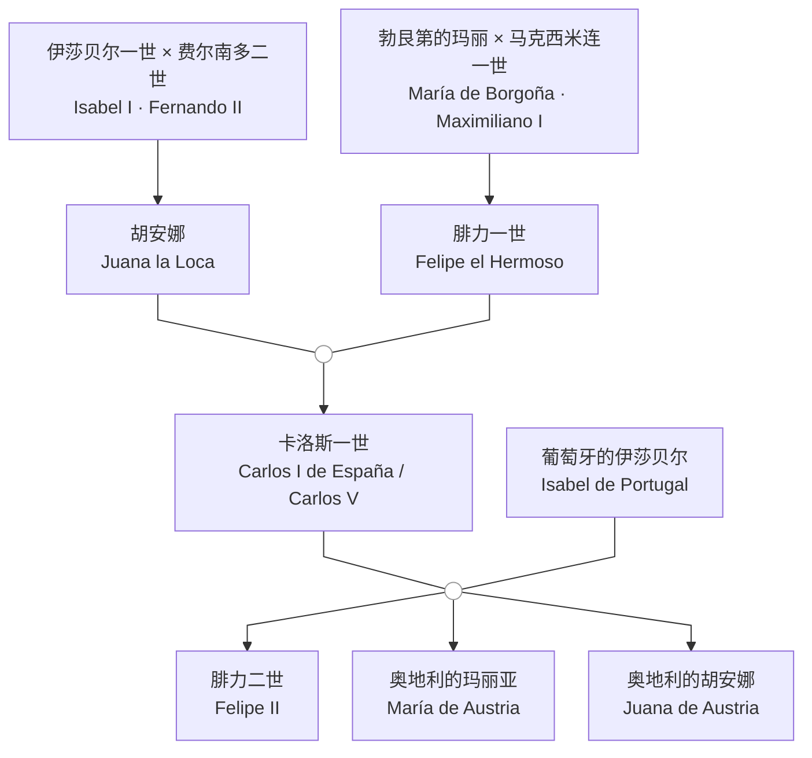

[[拉丁美洲史-导航|返回导航]] | [[主页|返回主页]] | [[第六课 26-10-21 拉美史|上一课]]

---
# 拉丁美洲的去殖民化（decolonization）
- 海地革命 1791 - 1804
- 西属美洲独立运动 1810 - 1826
- 巴西独立 1822 
- 多米尼加独立 1844 
- 古巴独立 1901 
- 1960 - 70年代，加勒比地区英国和荷兰殖民地独立
## 海地革命
### 革命的前序
- 1492年12月6日，哥伦布第一次航行中发现了海地岛，命名为小西班牙岛（Española），该岛成为向美洲大陆的一个基地；1603年开始，法国海盗开始在海地岛的西部开始殖民，侵扰西班牙殖民者；1697年，法国和西班牙签订《莱斯维克条约》（Treaty of Ryswick），把岛屿西部割让给法国，法国人将该岛命名为圣多明各岛（Saint-Domingue），建立了法属圣多明各殖民地，发展甘蔗种植业、糖业、咖啡种植业，成为了出产最丰富的法国殖民地；截至1779年，岛上人口约50万，白人4万，混血种人和自由黑人2万余，黑人奴隶48万。白人对非白人人口实行种族歧视。
- 1790年10月，混血种人领袖文森特·奥热（Vincent Ogé）率领250名混血种人和自由黑人组成的起义军宣布起义，但由于没有提出解放奴隶，没有受到黑人奴隶的支持，很快被镇压
- 黑人奴隶中通过非洲宗教相串联，密谋起义，计谋败露后起义被迫提前；1790年10月，杜桑·卢维杜尔（Toussaint Louverture，种植园中的家奴）烧毁了布雷达种植园（Breda），率领1000余人加入了起义队伍。
### 革命的过程
- 1793年，第一次反法联盟成立，英国和西班牙武装干涉，意欲夺取海地殖民地；西班牙招募黑人反抗法国，许诺给予参战奴隶自由，卢维杜尔率部加入西班牙一方，但西班牙无意废除奴隶制；1793年8月，法国特派员桑托纳克斯（Léonard Sonthonax）在圣多明各宣布废奴，1794年2月国民公会确认全法废奴，卢维杜尔受其鼓舞与西班牙决裂，击败了西班牙军队和随后登陆的英国军队
- 拿破仑上台后，计划以海地为基地，重新在美洲建立法属殖民帝国；1801年12月，拿破仑派遣其妹夫勒克莱尔（Charles Leclerc）率约两万远征军前往海地，1802年2月登陆，由于气候和疾病原因损失惨重；勒克莱尔假意和卢维杜尔谈判，将其扣下押往法国，卢维杜尔于1803年4月死于茹堡（Fort de Joux）；但奴隶起义军继续斗争，勒克莱尔本人也死于黄热病，法国在欧洲战事重启的情况下决定撤出海地，放弃建立殖民帝国的企图，于1803年将路易斯安那（Louisiana）以1500万美元低价出售给美国
- 1804年1月1日，德萨林（Jean-Jacques Dessalines）宣布海地独立，以泰诺语（Taíno）的“海地”（Ayiti，多山之地）作为国名
### 革命的影响
- 海地革命鼓舞了西属美洲独立运动吗？
## 西班牙的衰落

### 卡洛斯一世与腓力二世
- 1504年伊莎贝尔一世去世，遗嘱规定卡斯蒂利亚王位由胡安娜继承；胡安娜因精神疾病无法治政，费尔南多二世以摄政名义掌权；胡安娜的丈夫腓力一世纠结卡斯蒂利亚的贵族反对费尔南多，于1506年去世后，胡安娜被幽禁
- 1516年费尔南多二世去世，胡安娜之子卡洛斯继承卡斯蒂利亚与阿拉贡王位，称卡洛斯一世，名义上与其母胡安娜共治；1519年当选神圣罗马帝国皇帝，称查理五世（Carlos V），西班牙由此转入哈布斯堡王朝
- 卡洛斯一世时期，西班牙在美洲的征服迅速推进，在欧洲则长期与法国、奥斯曼帝国及新教诸侯交战；帝国版图达到极盛，财政却因战争开支与债务不断吃紧，1555至1556年卡洛斯一世先后在尼德兰、西班牙与神圣罗马帝国帝国退位，1558年去世
- 腓力二世（Felipe II）继承西班牙、尼德兰、意大利领地与美洲殖民地，西班牙帝国达到鼎盛。随后尼德兰革命自1568年爆发：税负加重、加尔文教的传播与地方自治传统，同西班牙的集权政策相冲突；1579年乌得勒支同盟（Unie van Utrecht）成立，1581年北方诸省宣布废黜腓力二世，战事长期消耗西班牙的军力与财力；1588年西班牙无敌舰队远征英国失败，被视为西班牙海上优势由盛转衰的标志。
- 1598年腓力二世去世，腓力三世继位；西班牙虽仍保有庞大帝国，但经济衰退、人口减少、多次财政破产与军事负担交织，进入长期的相对衰落。17世纪西班牙在腓力三世（Felipe III，1598-1621）、腓力四世（Felipe IV，1621-1665）与卡洛斯二世（Carlos II，1665-1700）治下继续相对衰落：三十年战争与尼德兰战争消耗国力，1640年葡萄牙脱离西班牙，1648年《威斯特伐利亚和约》承认荷兰独立。
### 西班牙王位继承战争和波旁改革
- 1700年11月1日卡洛斯二世去世，西班牙哈布斯堡王朝绝嗣。卡洛斯二世体弱多病，两度婚姻均无子嗣；他生前曾指定巴伐利亚的约瑟夫·费迪南德（Joseph Ferdinand）为继承人，后者1699年夭折，临终前改立法国国王路易十四之孙、安茹公爵腓力（Felipe de Anjou），并规定西班牙与法国王位不得合并。路易十四接受遗嘱，宣布其孙为西班牙国王腓力五世（Felipe V）；但法国与西班牙可能合并的前景引起奥地利哈布斯堡家族、英国、荷兰等反对，1701年西班牙王位继承战争（1701-1714）爆发。
- 反法同盟支持奥地利大公查理（即后来的皇帝查理六世）为西班牙国王；1711年约瑟夫一世去世、查理六世继位，同盟不愿哈布斯堡再度合并西班牙与帝国，1713至1714年《==乌得勒支和约==》（Treaty of Utrecht）及《拉施塔特和约》承认腓力五世为西班牙国王，但西班牙将欧洲大量领地割让出去：直布罗陀、梅诺卡割让给英国，西属尼德兰、米兰、那不勒斯转归奥地利，西西里归萨伏依；同时，英国通过《乌得勒支和约》取得了向西属美洲贩运奴隶的asiento（专营权）。
- 对西属美洲而言，波旁王朝取代哈布斯堡王朝，腓力五世及其后继者推行中央集权与重商主义改革，即18世纪的==波旁改革==（Bourbon Reforms）。
### 詹金斯之耳战争与七年战争
- **詹金斯之耳战争**（War of Jenkins' Ear，1739-1748）：起因于英西在加勒比海的走私与缉私冲突，1731年西班牙海岸警卫队割下英国船长詹金斯之耳，1739年英国对西班牙宣战。战事主要在加勒比海与北美南部进行，英军攻占波托贝洛，但1741年进攻卡塔赫纳惨败；战争后并入奥地利王位继承战争，1748年《亚琛和约》基本恢复战前状态；英国丧失了《乌德勒支条约》中获得的西属美洲奴隶贩运专营权
- **七年战争**（Seven Years' War，1756-1763）：英法全球争霸，西班牙于1761年签订第三次《家族协定》（Pacte de Famille），1762年参战。英军攻占加拿大、马提尼克、瓜德罗普，并于1762年占领哈瓦那和马尼拉；1763年《巴黎和约》中，法国将加拿大及密西西比河以东的路易斯安那割给英国，西班牙以佛罗里达换取哈瓦那和马尼拉，法国则将密西西比河以西的路易斯安那让给西班牙。
- 两场战争暴露了西班牙美洲防御与贸易体系的脆弱，直接推动卡洛斯三世时期的波旁改革：建立常备军与民兵、在古巴等地设置督抚（intendente）、逐步开放贸易港口。 