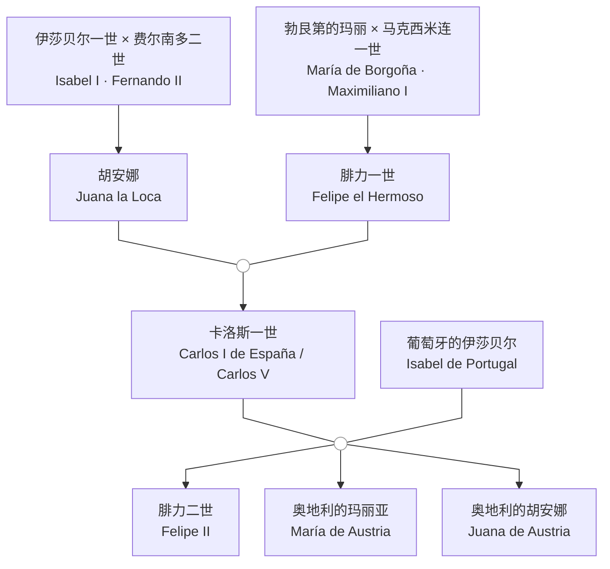

[[拉丁美洲史-导航|返回导航]] | [[主页|返回主页]] | [[第六课 26-10-21 拉美史|上一课]]

---
# 拉丁美洲的去殖民化（decolonization）
- 海地革命 1791 - 1804
- 西属美洲独立运动 1810 - 1826
- 巴西独立 1822 
- 多米尼加独立 1844 
- 古巴独立 1901 
- 1960 - 70年代，加勒比地区英国和荷兰殖民地独立
## 海地革命
### 革命的前序
- 1492年12月6日，哥伦布第一次航行中发现了海地岛，命名为小西班牙岛（Española），该岛成为向美洲大陆的一个基地；1603年开始，法国海盗开始在海地岛的西部开始殖民，侵扰西班牙殖民者；1697年，法国和西班牙签订《莱斯维克条约》（Treaty of Ryswick），把岛屿西部割让给法国，法国人将该岛命名为圣多明各岛（Saint-Domingue），建立了法属圣多明各殖民地，发展甘蔗种植业、糖业、咖啡种植业，成为了出产最丰富的法国殖民地；截至1779年，岛上人口约50万，白人4万，混血种人和自由黑人2万余，黑人奴隶48万。白人对非白人人口实行种族歧视。
- 1790年10月，混血种人领袖文森特·奥热（Vincent Ogé）率领250名混血种人和自由黑人组成的起义军宣布起义，但由于没有提出解放奴隶，没有受到黑人奴隶的支持，很快被镇压
- 黑人奴隶中通过非洲宗教相串联，密谋起义，计谋败露后起义被迫提前；1790年10月，杜桑·卢维杜尔（Toussaint Louverture，种植园中的家奴）烧毁了布雷达种植园（Breda），率领1000余人加入了起义队伍。
### 革命的过程
- 1793年，第一次反法联盟成立，英国和西班牙武装干涉，意欲夺取海地殖民地；西班牙招募黑人反抗法国，许诺给予参战奴隶自由，卢维杜尔率部加入西班牙一方，但西班牙无意废除奴隶制；1793年8月，法国特派员桑托纳克斯（Léonard Sonthonax）在圣多明各宣布废奴，1794年2月国民公会确认全法废奴，卢维杜尔受其鼓舞与西班牙决裂，击败了西班牙军队和随后登陆的英国军队
- 拿破仑上台后，计划以海地为基地，重新在美洲建立法属殖民帝国；1801年12月，拿破仑派遣其妹夫勒克莱尔（Charles Leclerc）率约两万远征军前往海地，1802年2月登陆，由于气候和疾病原因损失惨重；勒克莱尔假意和卢维杜尔谈判，将其扣下押往法国，卢维杜尔于1803年4月死于茹堡（Fort de Joux）；但奴隶起义军继续斗争，勒克莱尔本人也死于黄热病，法国在欧洲战事重启的情况下决定撤出海地，放弃建立殖民帝国的企图，于1803年将路易斯安那（Louisiana）以1500万美元低价出售给美国
- 1804年1月1日，德萨林（Jean-Jacques Dessalines）宣布海地独立，以泰诺语（Taíno）的“海地”（Ayiti，多山之地）作为国名
### 革命的影响
- 海地革命鼓舞了西属美洲独立运动吗？
## 西班牙的衰落

### 卡洛斯一世与腓力二世
- 1504年伊莎贝尔一世去世，遗嘱规定卡斯蒂利亚王位由胡安娜继承；胡安娜因精神疾病无法治政，费尔南多二世以摄政名义掌权；胡安娜的丈夫腓力一世纠结卡斯蒂利亚的贵族反对费尔南多，于1506年去世后，胡安娜被幽禁
- 1516年费尔南多二世去世，胡安娜之子卡洛斯继承卡斯蒂利亚与阿拉贡王位，称卡洛斯一世，名义上与其母胡安娜共治；1519年当选神圣罗马帝国皇帝，称查理五世（Carlos V），西班牙由此转入哈布斯堡王朝
- 卡洛斯一世时期，西班牙在美洲的征服迅速推进，在欧洲则长期与法国、奥斯曼帝国及新教诸侯交战；帝国版图达到极盛，财政却因战争开支与债务不断吃紧，1555至1556年卡洛斯一世先后在尼德兰、西班牙与神圣罗马帝国帝国退位，1558年去世
- 腓力二世（Felipe II）继承西班牙、尼德兰、意大利领地与美洲殖民地，西班牙帝国达到鼎盛。随后尼德兰革命自1568年爆发：税负加重、加尔文教的传播与地方自治传统，同西班牙的集权政策相冲突；1579年乌得勒支同盟（Unie van Utrecht）成立，1581年北方诸省宣布废黜腓力二世，战事长期消耗西班牙的军力与财力；1588年西班牙无敌舰队远征英国失败，被视为西班牙海上优势由盛转衰的标志。
- 1598年腓力二世去世，腓力三世继位；西班牙虽仍保有庞大帝国，但经济衰退、人口减少、多次财政破产与军事负担交织，进入长期的相对衰落。17世纪西班牙在腓力三世（Felipe III，1598-1621）、腓力四世（Felipe IV，1621-1665）与卡洛斯二世（Carlos II，1665-1700）治下继续相对衰落：三十年战争与尼德兰战争消耗国力，1640年葡萄牙脱离西班牙，1648年《威斯特伐利亚和约》承认荷兰独立。
### 西班牙王位继承战争和波旁王朝
- 1700年11月1日卡洛斯二世去世，西班牙哈布斯堡王朝绝嗣。卡洛斯二世体弱多病，两度婚姻均无子嗣；他生前曾指定巴伐利亚的约瑟夫·费迪南德（Joseph Ferdinand）为继承人，后者1699年夭折，临终前改立法国国王路易十四之孙、安茹公爵腓力（Felipe de Anjou），并规定西班牙与法国王位不得合并。路易十四接受遗嘱，宣布其孙为西班牙国王腓力五世（Felipe V）；但法国与西班牙可能合并的前景引起奥地利哈布斯堡家族、英国、荷兰等反对，1701年西班牙王位继承战争（1701-1714）爆发。
- 反法同盟支持奥地利大公查理（即后来的皇帝查理六世）为西班牙国王；1711年约瑟夫一世去世、查理六世继位，同盟不愿哈布斯堡再度合并西班牙与帝国，1713至1714年《==乌得勒支和约==》（Treaty of Utrecht）及《拉施塔特和约》承认腓力五世为西班牙国王，但西班牙将欧洲大量领地割让出去：直布罗陀、梅诺卡割让给英国，西属尼德兰、米兰、那不勒斯转归奥地利，西西里归萨伏依；同时，英国通过《乌得勒支和约》取得了向西属美洲贩运奴隶的asiento（专营权）。
- 对西属美洲而言，波旁王朝取代哈布斯堡王朝，腓力五世及其后继者推行中央集权与重商主义改革，即18世纪的波旁改革（Bourbon Reforms）。
### 詹金斯之耳战争与七年战争
- **詹金斯之耳战争**（War of Jenkins' Ear，1739-1748）：起因于英西在加勒比海的走私与缉私冲突，1731年西班牙海岸警卫队割下英国船长詹金斯之耳，1739年英国对西班牙宣战。战事主要在加勒比海与北美南部进行，英军攻占波托贝洛，但1741年进攻卡塔赫纳惨败；战争后并入奥地利王位继承战争，1748年《亚琛和约》基本恢复战前状态；英国丧失了《乌德勒支条约》中获得的西属美洲奴隶贩运专营权
- **七年战争**（Seven Years' War，1756-1763）：英法全球争霸，西班牙于1761年签订第三次《家族协定》（Pacte de Famille），1762年参战。英军攻占加拿大、马提尼克、瓜德罗普，并于1762年占领哈瓦那和马尼拉，英国占领期间进口了大量黑人奴隶和物美价廉的制成品，土生白人第一次感受到了自由贸易的好处；1763年《巴黎和约》中，法国将加拿大及密西西比河以东的路易斯安那割给英国，西班牙以佛罗里达换取哈瓦那和马尼拉，法国则将密西西比河以西的路易斯安那让给西班牙。
- **波旁改革**：1778年，西班牙颁布自由贸易法，允许西班牙美洲的24个港口可以直接与西班牙的任何港口进行直接贸易（但不能与西班牙势力范围以外的港口进行贸易）
	- 在经济上，为了增加来自殖民地的收入，王室不断增加专利公司垄断商品的种类，包括烟草、酒精、火药、盐等消费品，过去传统上由私商承包的捐税改由政府直接征收。所有买卖都要缴纳销售税，有些交易的税率从4%提高到6%，征收的办法也更加严格。为了振兴矿业，西班牙向殖民地派出了欧洲的工程和矿业技术人员，鼓励采用最新采矿技术，批准在墨西哥建立了矿业学院。
	- 政治上，第一，设立了两个新的总督辖区。1739年，成立新格拉纳达总督辖区，1776年，建立了以布宜诺斯艾利斯为首府的拉普拉塔总督辖区。还成立了新的都督辖区：委内瑞拉（1731年）、路易斯安那（1763年）、古巴（1777年）、智利（1778年）；第二，实行了监政官制度（Intendacy System），半岛人担任的监政官监督税收；第三，打击教会，1767年将耶稣会士驱逐出西班牙美洲，耶稣会的财产被拍卖，所得收归王室；第四，军事改革，为了加强殖民地防卫，西班牙在殖民地征召当地人建立民兵，同样享有军人特权
	- 改革促进了经济发展，但仍未能满足土生白人实行自由贸易的要求，且驱逐耶稣会士（当时已多由土生白人担任）、派遣监政官也引发了土生白人的不满，土生白人和宗主国之间的隔阂越来越大；同时，土生白人在拍卖教会财产、参与贸易中壮大了自己的力量；但同时，土生白人也面临来自社会底层的压力，土生白人需要借助宗主国的力量镇压起义，在面对印第安人和黑人奴隶起义的时候，土生白人和宗主国的利益仍是一致的（1780年图帕克·阿马鲁起义）；只有在土生白人认为宗主国无力维持殖民地秩序的情况下，土生白人才会宣布独立，抢在社会底层之前夺取政权，防止出现海地革命的情形危急自己的殖民利益
## 拿破仑西班牙与西属美洲独立运动
## 拿破仑占领西班牙
- 1808年3月，阿兰胡埃斯起义（Motín de Aranjuez）迫使卡洛斯四世退位，费尔南多七世即位；5月，拿破仑在巴约讷（Bayonne）迫使父子相继放弃王位，改立其兄约瑟夫·波拿巴为西班牙国王，马德里民众于5月2日起义，遭缪拉（Murat）军队镇压。费尔南多七世被囚禁，各地以费尔南多七世的名义成立洪达（junta），同年9月，各地洪达的代表在阿兰胡埃斯组成中央洪达（Junta Central Suprema），主要依靠洪达组织的游击战与英军支援。1810年1月中央洪达解散，由摄政会议（Regencia）接替；
## 西属美洲独立运动
- 在西属美洲，土生白人也成立了自己的洪达，和把持殖民地统治机构的半岛人爆发了矛盾，西属美洲独立战争爆发
### **墨西哥**
#### **伊达尔戈（Miguel Hidalgo）**
- 伊达尔戈宣言：1810年9月16日，多洛雷斯（Dolores）的克里奥尔神父伊达尔戈敲响教堂钟声，发表“多洛雷斯呼声”（Grito de Dolores），以费尔南多七世之名反对法国占领和半岛人政府，以瓜达卢佩圣母为旗号，号召印第安人、混血种人与克里奥尔人起事；1810年12月，起义军在瓜达拉哈拉颁布废除奴隶制、废除印第安人头税的法令，并创办《美洲觉醒报》（El Despertador Americano）。
- 瓜纳华托之战与大屠杀：1810年9月28日，起义军攻占瓜纳华托，城破后发生大屠杀；暴力与底层民众的广泛参与使土生白人担心重演海地革命，转而支持保皇派，起义的社会基础因此缩小
- 墨西哥城：1810年10月30日，伊达尔戈击败保皇军，打开通往墨西哥城的道路，但未进攻首都而撤回瓜达拉哈拉；1811年3月，伊达尔戈被俘，7月30日在奇瓦瓦（Chihuahua）就义。
#### **何塞·马里亚·莫雷洛斯（José María Morelos）**
- 莫雷洛斯是伊达尔戈之后墨西哥独立运动的主要领袖，混血种人神父出身；他在库奥特拉（Cuautla）组织防御并突破保皇军围困，随后攻占瓦哈卡（Oaxaca，1812年）和阿卡普尔科（Acapulco，1813年），将战事扩展至墨西哥南部。
- 1813年9月在奇尔潘辛戈（Chilpancingo）召开安纳瓦克议会（Congreso de Anáhuac），发表《民族意识》（Sentimientos de la Nación），主张独立、主权在民、废除奴隶制并实现种族平等；1814年颁布《阿帕辛甘宪法》（Constitución de Apatzingán），尝试建立共和政体。
- 1815年11月在特马拉卡（Temalaca）被俘，12月22日在埃卡特佩克（Ecatepec）被处死；余部由维森特·格雷罗（Vicente Guerrero）等继续抵抗
#### 奥古斯丁·德·伊图尔维德（Agustín de Iturbide）
- 保守派害怕西班牙1820年革命后的进步政策，为了保存自己的特权而脱离西班牙
- 1821年2月与格雷罗（Vicente Guerrero）发表《伊瓜拉计划》（Plan de Iguala），提出独立、天主教与西班牙人—美洲人团结三项保证；9月进入墨西哥城，宣布墨西哥独立。1822年加冕为墨西哥皇帝奥古斯丁一世，1823年在共和派与军队反对下退位，1824年回国时被处死
### 中美洲（危地马拉都督辖区）
- 1821年9月15日危地马拉宣布独立；1822年一度并入墨西哥帝国，1823年帝国崩溃后成立中美洲联合省（Provincias Unidas del Centro de América）
### 南美洲
#### 西蒙·玻利瓦尔（Simón Bolívar）
- 委内瑞拉第一、第二共和国：1811年加拉加斯宣布独立，建立第一共和国，1812年被保皇派推翻；1813年玻利瓦尔发动反攻，重建第二共和国，1814年再遭失败
- 委内瑞拉第三共和国：1817年在安戈斯图拉（Angostura）建立第三共和国；1819年玻利瓦尔翻越安第斯山，8月7日博亚卡战役（Boyacá）解放新格拉纳达，1821年6月24日卡拉沃沃战役（Carabobo）巩固委内瑞拉独立
- 大哥伦比亚共和国：1819年安戈斯图拉议会宣布成立大哥伦比亚，包括委内瑞拉与新格拉纳达，1822年厄瓜多尔加入；玻利瓦尔任总统，1830年共和国解体
#### 圣马丁（José de San Martín）
- 阿根廷独立战争领袖；1816年图库曼议会宣布独立后，1817年率军翻越安第斯山，支援智利独立；1820年由海路远征秘鲁，1821年7月28日宣布秘鲁独立。1822年与玻利瓦尔在瓜亚基尔（Guayaquil）会晤后退出政治，未再参与后续战争
#### 智利和秘鲁的解放
- 智利：奥希金斯（Bernardo O'Higgins）与圣马丁合作，1817年查卡布科战役（Chacabuco）、1818年迈普战役（Maipú）击败保皇军，1818年正式宣布独立
- 秘鲁：圣马丁1821年占领利马并宣布独立，但保皇派仍控制内陆；1824年苏克雷（Antonio José de Sucre）在**阿亚库乔战役**（Ayacucho）击败保皇军，秘鲁独立最终确立
## 巴西独立运动
- 1807年拿破仑入侵葡萄牙，摄政王若昂（后来的若昂六世）在英国舰队护送下率宫廷迁往巴西，1808年抵达萨尔瓦多，后定都里约热内卢；1808年巴西港口对外开放，1815年巴西升格为王国，与葡萄牙、阿尔加维组成联合王国。
- 1820年8月波尔图爆发自由主义革命，要求制定宪法、召回若昂六世；1821年若昂六世返回里斯本，其子佩德罗（Pedro）留任巴西摄政。里斯本议会试图恢复巴西的殖民地地位并召回佩德罗；1822年1月9日佩德罗宣布留在巴西，9月7日在伊皮兰加河畔宣布独立（Grito do Ipiranga），12月加冕为佩德罗一世。
- 1822至1823年巴西独立战争击败葡军；1825年葡萄牙在《里约热内卢条约》中承认巴西独立，巴西支付200万英镑赔偿；佩德罗一世于1831年退位，其子佩德罗二世继位。
![[Pasted image 20261028145155.jpg]] “独立或死亡”，佩德罗一世