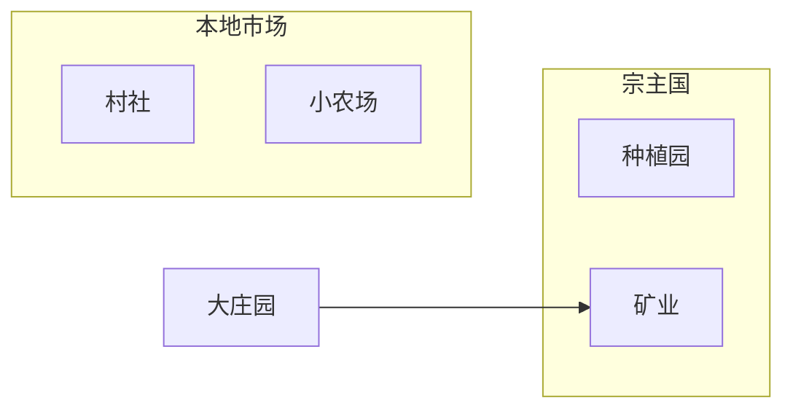

[[拉丁美洲史-导航|返回导航]] | [[主页|返回主页]] | [[第四课 26-9-30 拉美史|上一课]]

---
# 西班牙美洲的殖民体制
## 殖民地的经济：矿业
- 重商主义背景：殖民地商品运输到本国销售，剩余产品出口其它国家，赚取贵金属，同时国家鼓励出口，限制进口，维持贸易顺差（以贵金属衡量）
- 殖民者早期获取贵金属的方式：战利品
- 殖民征服后获取贵金属的方式：矿产
	- 金矿：1501 - 1519年，加勒比地区生产了价值约合800万比索的黄金；西班牙征服墨西哥和秘鲁后，西班牙黄金生产的中心从西印度群岛转移到格拉纳达；生产方式主要是淘金冶炼
	- 银矿：主要集中在墨西哥北部和秘鲁高原地区，尤其在今玻利维亚的波托西（Potosi），主要生产方式是熔炼法（方法较简单，依赖燃料熔化矿石冶炼，是美洲原有的金属冶炼法）和汞齐法（提升产量、使低品位矿石得以冶炼，由西班牙人发明，但以来欧洲的水银供应）
	- 银矿的生产所需的蜡烛、袋子、梯子以及劳工体力，带动了对牛油、牛肉、皮革等的需求，带动了农牧业和手工业的发展，同时也形成了城市；可以说**殖民地的整个经济系统是围绕矿产进行的**
	- ![[Pasted image 20261014131422.jpg|205]] 波托西银矿矿山
- 白银流入西班牙，又在西班牙大量购买西北欧国家制成品的过程中流入英法等国，引起了普遍的通货膨胀和“价格革命”，促进了工业的发展；
## 殖民地的经济：农业
- 大庄园与村社
	- 大庄园（Hacienda）：由征服者中地位较高者被授予的土地形成，是一个幅员辽阔的种植粮食或牲畜畜牧的地产，产品在当地**供采矿中心或大都市消费**；美洲印第安人构成依附的和相对不流动的劳动力，西班牙人通过工资劳动、劳役偿债的特殊形式对其进行控制；西班牙人起初满足于直接向印第安人口征税，而非重新组织农牧业的生产活动；但随着印第安人口的剧减，可以收取的赋税减少，大量土地荒芜，加上西班牙殖民者的到来和矿业的兴盛，新的大庄园经济兴起
	- 村社（Ejido）：为**方便传教**，西班牙殖民政府将散居的幸存印第安人集中起来形成村社，由政府授予一定的土地分给每家每户，同时保留一些公用土地
	- 随着原住民对旧大陆疾病逐步建立免疫，村社人口出现了回升，人地矛盾导致村社人口前往大庄园劳动，形成了村社和大庄园不平等的相互依赖关系
- 小农场（Rancho）：西班牙征服者中普通士兵通过分配获得的土地，普通士兵通常娶印第安人为妻，形成混血社群；小农场主要集中在边疆地区，自产自销或面向本地市场销售
- 种植园（Plantacion）：不同于大庄园（Hacienda），目的是为欧洲生产大宗商品；起初集中在岛屿上，由于原住民人口灭绝，主要使用黑人奴隶作为劳动力，专精一种出口产品的生产

## 殖民地的劳动制度
- 印第安人奴隶制：直接进行人口掠夺和奴隶劳动
### 委托监护制（encomienda）
- 委托监护制的建立：
	- 作为对哥伦布第二次航行中殖民者暴动的回应，1498年，哥伦布同意向西班牙殖民者分配印第安人，根据这种分配制（repartimientos），将一个印第安酋长及其所属的印第安人委派给一个委托监护主（encomendo），印第安人在属于后者的矿山或地产上劳动
	- 这一制度被西班牙君主出于压抑贵族的目的废除，1503年，女王通过敕书（cedula）对新大陆的委托监护制予以合法化和制度化。根据这种制度，一定数目的印第安人被“委托”给某个西班牙人（即encomendero），由他以及聘请的传教士向他们传播基督教和西方文明，并保护印第安人，作为回报，委托监护主被授予征调劳动力和贡物的权利
	- 高强度的劳动和过高人口密度导致印第安人口在劳动重压和疾病的折磨下去世，Hispaniola岛上700万人的印第安人只剩2万人，几乎被灭绝
- 对委托监护制的反应：
	- 在1511年，多明我会修士安东尼奥·德·蒙特西诺斯在圣多明各在布道会中拒绝让委托监护主领受圣餐，并谴责了他们的罪行
	- 巴托洛梅·德·拉斯卡萨斯《西印度毁灭述略》记述了殖民者在新大陆的残酷行径，认为教皇将新大陆委托给西班牙的目的在于传播基督教而非强迫印第安人为西班牙人劳动，主张将非传教士的西班牙委托监护主送回旧大陆
	- 拉斯卡萨斯的想法这与国王压制殖民地新贵族的想法不谋而合，1512年公布了《布尔戈斯法》，宣示印第安人是自由人、非奴隶，须被引导皈依基督教；但劳动并未取消，西班牙人仍可以命令其劳动，前提是不妨碍皈依、强度可承受
	- 科尔特斯征服墨西哥后，王室禁止实行委托监护制，但最终向科尔特斯和征服者妥协。1542年，王室颁布新法，新法严厉禁止印第安人奴隶制，禁止在种植园和矿业中强制性地使用印第安人劳动力，委托监护权不得世袭，所有印第安人劳工必须得到合理的工资，印第安人缴纳的税收和贡品必须合理、适度；该法案受到殖民者的强烈反对，最终，王室删除了禁止委托监护权世袭这一款，双方达成妥协
- 委托监护制的式微：随着印第安人口下降，委托监护制逐渐消亡
### 劳力征调制（新西班牙repartimiento制、秘鲁mita制）
- 每个村社有义务在一定时间内送出年轻有力的男子服劳役一定的时间，在新西班牙主要服务于农业，在秘鲁主要服务于矿业
	- 例如：1572年年底，秘鲁总督弗朗西斯科·德·托莱多在巡视秘鲁全境途中从库斯科来到波托西，并在那里推行米达制，指示从秘鲁总督辖区的16个省征调劳力前往波托西服役。提供劳动力的地区中，大约14%（1/7）的缴纳人头税的人口（18岁到50岁的男子）每七年要到波托西服役一年
### 雇佣劳动制
-  随着印第安人口进一步下降，庄园主和矿主为了获得稳定的劳动力，直接与印第安人签订合同，付给的工资通常略高于摊派劳役制下的劳工工资水平，这一制度起初是摊牌劳动的补充，但越来越取代前者称为主要的劳动制度
- 从雇佣劳动制延伸出来了债务劳役制，西班牙人通过在仪式时向印第安人借贷，用债务将印第安劳动力固定在矿区和庄园
### 黑人奴隶制
- 西印度群岛甘蔗种植业迅速发展，主要是英法荷与西班牙王室签订协议（asiento）进行奴隶贸易，将黑人送往美洲。由于奴隶价格高昂，黑人奴隶仅在有利可图的种植园、富有家庭的家务劳动、少量黄金矿产中使用，集中在委内瑞拉和哥伦比亚沿海的可可、甘蔗种植园中
## 殖民地的贸易政策
### 西班牙贸易制度
- 国王将从殖民地贸易的权利指定给少部分西班牙大商人，规定殖民地只能与宗主国进行贸易，殖民地与外国、殖民地之间的贸易都受到压制。
- 1503年，在塞维利亚（Seville）成立贸易署（Casa de Contratacion），规定只有本土的加迪斯（Cadiz）和塞维利亚、新西班牙的维拉克鲁斯（Veracruz）、巴拿马的波托贝洛（Portobelo）两口可以通商贸易
- 并实行双船队制度：每年派送两只军舰护送的船队，一只新西班牙船队（Flota de Nueva España）四月启航，取道加那利群岛、多米尼加、波多黎各，驶往墨西哥的维拉克鲁斯（Veracruz，圣胡安·德·乌卢阿 San Juan de Ulúa 要塞）；一只南美大陆船队（Galeones de Tierra Firme）八月启航，驶往南美大陆，主要停靠卡塔赫纳（Cartagena，今哥伦比亚）和巴拿马地峡的波托贝洛（Portobelo，1596年前为 Nombre de Dios）
- 秘鲁白银先由南海船队从卡亚俄（Callao）运抵巴拿马城，再经地峡陆路运至波托贝洛装船；波托贝洛每年举办约四十天的集市（feria），南美各地商人携金银来此换取欧洲商品两支船队在美洲过冬，次年在古巴哈瓦那（Havana）会合，由护航军舰护送经巴哈马海峡、亚速尔群岛返回西班牙，以避飓风与海盗
![[Pasted image 20261014143348.png|760]]
### 其它列强的反应
- 海盗：德雷克、霍金斯等国家授权的海盗，在加勒比海地区直接抢劫西班牙的宝船
- 走私：直接和当地人进行交易，走私和贸易据点逐步发展为同时进行甘蔗种植、晒盐等生产活动的小型殖民地
### 马尼拉大帆船贸易

