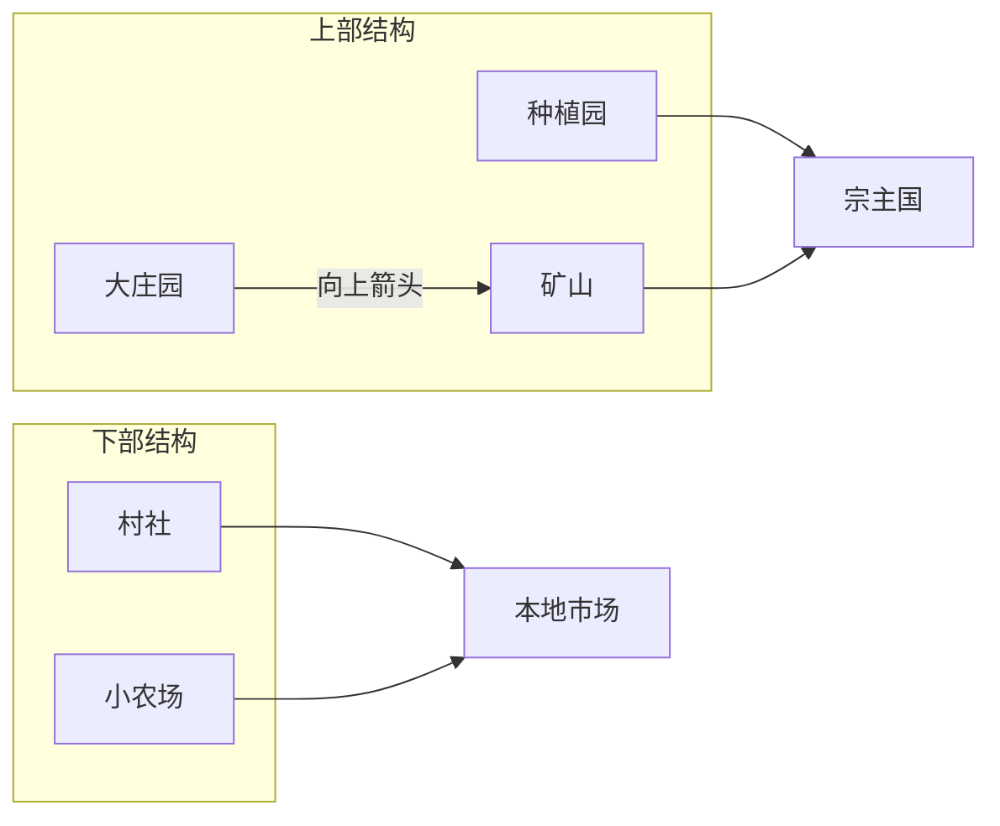

[[拉丁美洲史-导航|返回导航]] | [[主页|返回主页]] | [[第四课 26-9-30 拉美史|上一课]]

---
# 西班牙美洲的殖民体制
## 殖民地的经济：矿业
- 重商主义背景：殖民地商品运输到本国销售，剩余产品出口其它国家，赚取贵金属，同时国家鼓励出口，限制进口，维持贸易顺差（以贵金属衡量）
- 殖民者早期获取贵金属的方式：战利品
- 殖民征服后获取贵金属的方式：矿产
	- 金矿：1501 - 1519年，加勒比地区生产了价值约合800万比索的黄金；西班牙征服墨西哥和秘鲁后，西班牙黄金生产的中心从西印度群岛转移到格拉纳达；生产方式主要是淘金冶炼
	- 银矿：主要集中在墨西哥北部和秘鲁高原地区，尤其在今玻利维亚的波托西（Potosi），主要生产方式是熔炼法（方法较简单，依赖燃料熔化矿石冶炼，是美洲原有的金属冶炼法）和汞齐法（提升产量、使低品位矿石得以冶炼，由西班牙人发明，但以来欧洲的水银供应）
	- 银矿的生产所需的蜡烛、袋子、梯子以及劳工体力，带动了对牛油、牛肉、皮革等的需求，带动了农牧业和手工业的发展，同时也形成了城市；可以说**殖民地的整个经济系统是围绕矿产进行的**
	- ![[Pasted image 20261014131422.jpg|205]] 波托西银矿矿山
- 白银流入西班牙，又在西班牙大量购买西北欧国家制成品的过程中流入英法等国，引起了普遍的通货膨胀和“价格革命”，促进了工业的发展；
## 殖民地的经济：农业
- 大庄园与村社
	- 大庄园（Hacienda）：由征服者中地位较高者被授予的土地形成，是一个幅员辽阔的种植粮食或牲畜畜牧的地产，产品在当地**供采矿中心或大都市消费**；美洲印第安人构成依附的和相对不流动的劳动力，西班牙人通过工资劳动、劳役偿债的特殊形式对其进行控制；西班牙人起初满足于直接向印第安人口征税，而非重新组织农牧业的生产活动；但随着印第安人口的剧减，可以收取的赋税减少，大量土地荒芜，加上西班牙殖民者的到来和矿业的兴盛，新的大庄园经济兴起
	- 村社（Ejido）：为**方便传教**，西班牙殖民政府将散居的幸存印第安人集中起来形成村社，由政府授予一定的土地分给每家每户，同时保留一些公用土地
	- 随着原住民对旧大陆疾病逐步建立免疫，村社人口出现了回升，人地矛盾导致村社人口前往大庄园劳动，形成了村社和大庄园不平等的相互依赖关系
- 小农场（Rancho）：西班牙征服者中普通士兵通过分配获得的土地，普通士兵通常娶印第安人为妻，形成混血社群；小农场主要集中在边疆地区，自产自销或面向本地市场销售
- 种植园（Plantacion）：不同于大庄园（Hacienda），目的是为欧洲生产大宗商品；起初集中在岛屿上，由于原住民人口灭绝，主要使用黑人奴隶作为劳动力，专精一种出口产品的生产

## 殖民地的劳动制度
- 印第安人奴隶制：直接进行人口掠夺和奴隶劳动
- 委托监护制（encomienda）：
	- 作为对哥伦布第二次航行中殖民者暴动的回应，1498年，哥伦布同意向西班牙殖民者分配印第安人，根据这种分配制（repartimientos），将一个印第安酋长及其所属的印第安人委派给一个委托监护主（encomendo），印第安人在属于后者的矿山或地产上劳动
	- 这一制度被西班牙君主出于压抑贵族的目的废除，1503年，女王通过敕书（cedula）对新大陆的委托监护制予以合法化和制度化。根据这种制度，一定数目的印第安人被“委托”给某个西班牙人（即encomendero），由他以及聘请的传教士向他们传播基督教和西方文明，并保护印第安人，作为回报，委托监护主被授予征调劳动力和贡物的权利